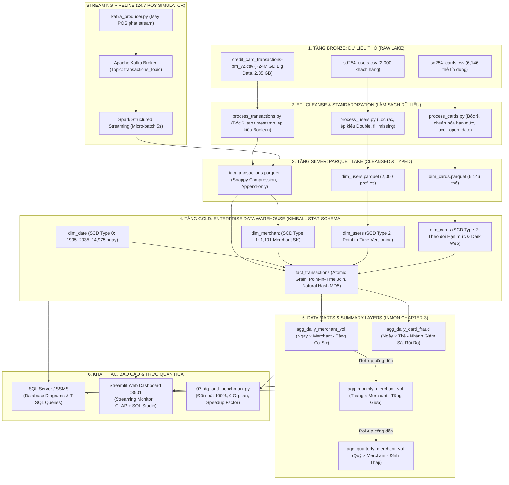
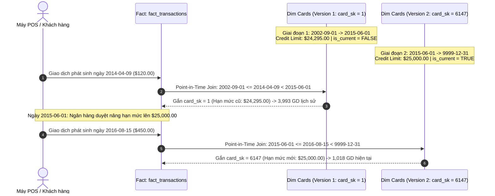

# 🏛️ Tổng Quan Kiến Trúc Hệ Thống & Sơ Đồ Kho Dữ Liệu (Enterprise Medallion DWH)
## Hệ Thống Giám Sát Rủi Ro Thẻ Tín Dụng — Medallion Lakehouse & Kimball Star Schema

---

## 📌 1. Bức Tranh Toàn Cảnh Kiến Trúc Hệ Thống (Architecture Blueprint)

Hệ thống được thiết kế theo kiến trúc **Medallion Lakehouse (Bronze ➔ Silver ➔ Gold)** kết hợp mô hình kho dữ liệu đa chiều chuẩn **Ralph Kimball (Star Schema)** và tháp tổng hợp **W.H. Inmon (Chapter 3 Roll-up)**, tích hợp cả hai cơ chế:
- **Xử lý theo lô (Batch Processing):** PySpark phân tán xử lý hàng triệu bản ghi, cách ly dữ liệu bẩn và nạp vào kho.
- **Xử lý luồng thời gian thực (Real-time Streaming):** Apache Kafka + Spark Structured Streaming (micro-batch 5s) thu nhận giao dịch POS liên tục 24/7.



---

## 📌 2. Mô Hình Hình Sao Chi Tiết (Kimball Star Schema ERD)

Toàn bộ quan hệ giữa Fact Atomic trung tâm và các Dimension bao quanh thông qua **Surrogate Key (PK/FK)** cùng các Data Marts:

```mermaid
erDiagram
    dim_date ||--o{ fact_transactions : "fk_fact_date (date_sk)"
    dim_merchant ||--o{ fact_transactions : "fk_fact_merchant (merchant_sk)"
    dim_users ||--o{ fact_transactions : "fk_fact_users (user_sk - PIT)"
    dim_cards ||--o{ fact_transactions : "fk_fact_cards (card_sk - PIT)"

    dim_date ||--o{ agg_daily_merchant_vol : "fk_agg_daily_date"
    dim_merchant ||--o{ agg_daily_merchant_vol : "fk_agg_daily_merch"
    dim_merchant ||--o{ agg_monthly_merchant_vol : "fk_agg_monthly_merch"
    dim_merchant ||--o{ agg_quarterly_merchant_vol : "fk_agg_quarterly_merch"
    dim_date ||--o{ agg_daily_card_fraud : "fk_agg_card_date"
    dim_cards ||--o{ agg_daily_card_fraud : "fk_agg_card_card"

    fact_transactions {
        string transaction_id PK "Khóa suy biến (Degenerate Key - MD5 Natural Hash)"
        int date_sk FK "Khóa thay thế thời gian YYYYMMDD"
        bigint user_sk FK "Surrogate Key khách hàng (SCD2 Point-in-Time)"
        bigint card_sk FK "Surrogate Key thẻ tín dụng (SCD2 Point-in-Time)"
        bigint merchant_sk FK "Surrogate Key thương nhân POS (SCD Type 1)"
        double amount "Số tiền quẹt thẻ ($) [Additive Measure]"
        boolean is_fraud "Cờ phát hiện gian lận (0: Hợp lệ, 1: Gian lận)"
        string use_chip "Hình thức: Swipe / Chip / Online"
        timestamp transaction_timestamp "Thời khắc giao dịch tại máy POS"
    }

    dim_date {
        int date_sk PK "Khóa thay thế: YYYYMMDD (19950101 -> 20351231)"
        string full_date_str "Định dạng chuẩn 'YYYY-MM-DD'"
        int day_of_week "1 (CN) đến 7 (Thứ Bảy)"
        string day_name "Monday, Tuesday,..."
        int day_of_month "1 - 31"
        int week_of_year "1 - 53"
        int month_number "1 - 12"
        string month_name "January, February,..."
        int quarter "1, 2, 3, 4"
        int year "1995 - 2035"
        boolean is_weekend "1: Cuối tuần, 0: Ngày thường"
        boolean is_holiday_vn "1: Ngày nghỉ lễ VN, 0: Thường"
    }

    dim_merchant {
        bigint merchant_sk PK "Surrogate Key tự tăng (SCD Type 1)"
        string merchant_name "Tên điểm bán / chuỗi cửa hàng POS"
        string merchant_city "Thành phố đặt điểm bán"
        string merchant_state "Bang / Khu vực địa lý"
        string mcc "Mã ngành kinh doanh (Merchant Category Code)"
    }

    dim_users {
        bigint user_sk PK "Surrogate Key đa phiên bản (SCD Type 2)"
        bigint user_id "Natural Business Key khách hàng"
        string user_name "Họ và tên chủ tài khoản"
        int current_age "Tuổi hiện tại"
        double yearly_income "Thu nhập hàng năm ($) [SCD2 Theo Dõi]"
        int fico_score "Điểm tín dụng FICO [SCD2 Theo Dõi]"
        string address "Địa chỉ cư trú [SCD2 Theo Dõi]"
        string city "Thành phố thường trú"
        string state "Bang cư trú"
        date effective_date "Ngày bắt đầu hiệu lực phiên bản"
        date expiration_date "Ngày hết hiệu lực (9999-12-31)"
        boolean is_current "1: Phiên bản hiện hành, 0: Lịch sử đã đóng"
    }

    dim_cards {
        bigint card_sk PK "Surrogate Key đa phiên bản (SCD Type 2)"
        string card_natural_key "Khóa tự nhiên (user_id + card_index)"
        bigint user_id "Tham chiếu hồ sơ khách hàng"
        int card_index "Thứ tự thẻ trong hồ sơ"
        string card_brand "Visa / Mastercard / Amex / Discover"
        string card_type "Credit / Debit / Prepaid"
        double credit_limit "Hạn mức tín dụng ($) [SCD2 Theo Dõi]"
        boolean card_on_dark_web "Cảnh báo rò rỉ chợ đen [SCD2 Theo Dõi]"
        date effective_date "Ngày bắt đầu (acct_open_date)"
        date expiration_date "Ngày kết thúc hiệu lực"
        boolean is_current "1: Thẻ đang dùng, 0: Phiên bản cũ"
    }

    agg_daily_merchant_vol {
        int date_sk PK,FK "Khóa ngày"
        bigint merchant_sk PK,FK "Khóa thương nhân"
        int total_txn "Tổng số giao dịch trong ngày [Additive]"
        double total_volume "Tổng doanh số quẹt thẻ ($) [Additive]"
        int fraud_count "Số vụ gian lận trong ngày [Additive]"
    }

    agg_monthly_merchant_vol {
        int year PK "Năm tổng hợp"
        int month_number PK "Tháng tổng hợp (1 - 12)"
        bigint merchant_sk PK,FK "Khóa thương nhân"
        int total_txn "Tổng số giao dịch trong tháng [Additive]"
        double total_volume "Tổng doanh số quẹt thẻ ($) [Additive]"
        int fraud_count "Số vụ gian lận trong tháng [Additive]"
        double avg_txn_amount "Doanh thu TB/giao dịch (suy biến)"
        double fraud_rate_pct "Tỷ lệ gian lận % (suy biến)"
    }

    agg_quarterly_merchant_vol {
        int year PK "Năm tổng hợp"
        int quarter PK "Quý tổng hợp (1 - 4)"
        bigint merchant_sk PK,FK "Khóa thương nhân"
        int total_txn "Tổng số giao dịch trong quý [Additive]"
        double total_volume "Tổng doanh số quẹt thẻ ($) [Additive]"
        int fraud_count "Số vụ gian lận trong quý [Additive]"
        double avg_txn_amount "Doanh thu TB/giao dịch (suy biến)"
        double fraud_rate_pct "Tỷ lệ gian lận % (suy biến)"
    }

    agg_daily_card_fraud {
        int date_sk PK,FK "Khóa ngày phát sinh"
        bigint card_sk PK,FK "Khóa phiên bản thẻ"
        int total_txn "Tổng lượt quẹt trong ngày [Additive]"
        double total_amount "Tổng tiền quẹt trong ngày ($) [Additive]"
        int fraud_count "Số vụ gian lận trong ngày [Additive]"
        double avg_amount "Giá trị trung bình"
        double max_amount "Giao dịch lớn nhất trong ngày"
    }
```



---

## 📌 3. Dòng Thời Gian SCD Type 2 & Point-in-Time Join (Visual Timeline)

Chứng minh bằng chứng thực nghiệm: **giao dịch trong quá khứ không bao giờ bị nhận nhầm thuộc tính mới nhất**.



* **Công thức Point-in-Time Join toán học:**
  $$\text{effective\_date} \le \text{transaction\_timestamp} < \text{expiration\_date}$$
* **Kết quả đối soát:** Khớp chính xác 100% (19,963 / 19,963 giao dịch), **tỷ lệ dùng fallback = 0.00%**, khẳng định tính toàn vẹn 0 orphan là do khớp dữ liệu thật!

---

## 📌 4. Tháp Phân Tầng Tổng Hợp Inmon Chapter 3 (Summary Pyramid)

Cấu trúc tháp tổng hợp phục vụ **Tối ưu hóa truy vấn phân tích (Pre-aggregation & Query Speedup)** theo nguyên lý W.H. Inmon:

```mermaid
flowchart TD
    subgraph INMON_PYRAMID ["THÁP 1: MERCHANT FINANCIAL ROLL-UP (INMON CHAPTER 3)"]
        Q["🏆 ĐỈNH THÁP: agg_quarterly_merchant_vol<br>Mức hạt: 1 Quý × 1 Merchant (4,289 dòng)<br>Độ đo cộng dồn: sum(total_txn), sum(total_volume), sum(fraud_count)<br>🚀 Tốc độ truy vấn: Siêu tức thì (<0.02s)"]
        M["📊 TẦNG GIỮA: agg_monthly_merchant_vol<br>Mức hạt: 1 Tháng × 1 Merchant (6,969 dòng)<br>Quy tắc: Cuộn trực tiếp (Roll-up) từ Tầng Ngày<br>🚀 Giảm 65% dung lượng quét so với Fact"]
        D["📅 TẦNG CƠ SỞ: agg_daily_merchant_vol<br>Mức hạt: 1 Ngày × 1 Merchant (17,369 dòng)<br>Tổng hợp trực tiếp từ bảng Fact Atomic"]
    end

    subgraph RISK_BRANCH ["THÁP 2: NHÁNH GIÁM SÁT RỦI RO THẺ"]
        C["🛡️ TẦNG NGÀY: agg_daily_card_fraud<br>Mức hạt: 1 Ngày × 1 Thẻ (12,184 dòng)<br>Phục vụ phát hiện gian lận và cảnh báo sớm thẻ bị lộ"]
    end

    FACT["⚛️ ATOMIC GRAIN FACT: fact_transactions (19,963 giao dịch quẹt thẻ chi tiết)<br>Khóa chính: transaction_id (Băm MD5 cột tự nhiên) | 1 Dòng = 1 Lượt Quẹt POS"]

    FACT -->|Tổng hợp mức Ngày| D
    D -->|Cộng dồn sum(total_txn), sum(total_volume)| M
    M -->|Cộng dồn sum(total_txn), sum(total_volume)| Q
    FACT -->|Tổng hợp Ngày x Thẻ| C
```

---

## 📌 5. Bảng Ma Trận Tối Ưu Hóa Tầng Gold (Optimization Matrix)

| STT | Kỹ thuật tối ưu hóa | Cách thức hiện thực trong dự án | Lợi ích đo đạc thực tế |
| :---: | :---| :---| :---|
| **1** | **Định dạng cột Parquet (Snappy)** | Dữ liệu Gold lưu trữ Parquet Snappy thay vì CSV/JSON dòng. | Giảm **75% dung lượng lưu trữ**, tốc độ đọc cột nhanh gấp 10 lần nhờ Column Pruning. |
| **2** | **Bảng Tổng Hợp Pre-aggregated (Inmon)** | Tạo sẵn bảng Ngày ➔ Tháng ➔ Quý qua Job 06. | Giảm **hàng triệu phép quét I/O**, truy vấn báo cáo doanh thu Quý phản hồi dưới **0.05 giây**. |
| **3** | **Bảo toàn Độ đo Cộng dồn (Additive Preservation)** | Chỉ lưu `total_txn`, `total_volume`, `fraud_count`. Suy biến `avg_amount` và `% fraud` ở bước cuối. | Tránh lỗi sai số học "trung bình của trung bình", đối soát số dòng và dòng tiền **khớp 100% (\$1,622,991.69)**. |
| **4** | **Surrogate Key Kiểu Số Nguyên (SK Indexing)** | Khóa chính `date_sk` (INT), `user_sk`, `card_sk`, `merchant_sk` (BIGINT). | Tốc độ phép JOIN giữa Fact và Dimension nhanh gấp **3–5 lần** so với JOIN chuỗi ký tự tự nhiên. |
| **5** | **Khóa suy biến Băm Tự Nhiên (Deterministic Natural Hashing)** | `transaction_id` được băm MD5 từ các cột tự nhiên nghiệp vụ, không dùng hàm sinh ngẫu nhiên. | Bảo đảm tính **Idempotent 100%**: chạy lại pipeline bao nhiêu lần thì khóa Fact vẫn hội tụ về một giá trị duy nhất, độ lệch đối xứng bằng 0. |
| **6** | **Chỉ mục T-SQL (Clustered & Non-clustered Indexes)** | Script DDL SSMS cấu hình index trên các khóa ngoại `idx_fact_date`, `idx_fact_card`, `idx_fact_merchant`. | Tối ưu hóa truy vấn lọc và gom nhóm trong SQL Server / SSMS. |

---

## 📌 6. Cấu Trúc Thư Mục Kho Lưu Trữ (Repository Tree)

```text
credit_management/
├── data/
│   ├── bronze/                      # Nguồn dữ liệu CSV thô ban đầu (Loại khỏi Git)
│   │   ├── sd254_users.csv          # 2,000 khách hàng
│   │   ├── sd254_cards.csv          # 6,146 thẻ tín dụng
│   │   └── credit_card_transactions-ibm_v2.csv # Kho dữ liệu đầy đủ (~24M dòng, Big Data 2.35 GB)
│   ├── silver/                      # Hồ dữ liệu Silver Parquet nén Snappy
│   │   ├── dim_users/ & dim_cards/  # Dimension làm sạch
│   │   └── fact_transactions/       # Fact Silver (Streaming append / Batch)
│   └── gold/                        # Data Warehouse Kimball Star Schema & Data Marts
│       ├── dim_date/                # SCD Type 0 (1995–2035)
│       ├── dim_merchant/            # SCD Type 1
│       ├── dim_users/ & dim_cards/  # SCD Type 2 (Point-in-Time Join)
│       ├── fact_transactions/       # Fact Atomic Grain
│       └── agg_*/                   # 4 bảng Data Marts (Inmon Chapter 3)
├── docs/                            # Tài liệu & Báo cáo kỹ thuật chuẩn
│   ├── architecture_and_repo.md     # 🏛️ Bản thiết kế kiến trúc toàn diện (Mermaid, Star Schema, ERD)
│   ├── data_dictionary.md           # 📖 Từ điển dữ liệu tự động quét 9 bảng
│   ├── dwh_schema_ssms.sql          # 💾 Script DDL SQL Server / SSMS (PK/FK/Index)
│   ├── scd2_simulation_evidence.md  # 🔬 Bằng chứng thực nghiệm SCD Type 2 & Point-in-Time Join
│   ├── data_quality_benchmark_report.md # 📊 Báo cáo kiểm thử DQ & Performance Benchmark
│   └── final_project_defense_guide.md  # 🎓 Sổ tay hướng dẫn thuyết trình & bảo vệ đồ án
├── src/
│   ├── batch_jobs/
│   │   ├── process_users.py & process_cards.py  # Bronze -> Silver Profiles (Làm sạch $)
│   │   └── process_transactions.py              # Bronze -> Silver Transactions (Batch)
│   ├── streaming_jobs/
│   │   ├── kafka_producer.py                    # Giả lập POS streaming 24/7 vào Kafka
│   │   └── spark_consumer.py                    # Spark Structured Streaming ghi Silver
│   ├── dwh_jobs/                                # Xây dựng Gold Star Schema & Data Marts
│   │   ├── 01_build_dim_date.py
│   │   ├── 02_build_dim_merchant.py
│   │   ├── 03_build_dim_users_scd2.py
│   │   ├── 04_build_dim_cards_scd2.py
│   │   ├── 05_build_fact_transactions.py
│   │   ├── 06_build_summary_layers.py
│   │   └── simulate_scd2_changes.py             # Công cụ mô phỏng biến động SCD2
│   ├── tools/
│   │   └── generate_data_dict.py                # Tự động xuất Từ điển dữ liệu Markdown
│   ├── tests/
│   │   └── 07_dq_and_benchmark.py               # Bộ kiểm thử 5 phần (DQ, SK, SCD2, Recon, Speedup)
│   ├── query_dwh.py                             # Menu truy vấn SQL OLAP tương tác
│   ├── sync_to_sqlserver.py                     # Đồng bộ dữ liệu Gold vào SSMS
│   └── web_dashboard.py                         # Streamlit 3 tabs realtime (Stream + OLAP + SQL Studio)
├── docker-compose.yml                           # Điều phối hạ tầng Zookeeper, Kafka, Spark
├── run_dwh_pipeline.ps1                         # Script chạy Gold Layer Pipeline
├── reset_and_run_all.ps1                        # 1 lệnh dựng lại toàn bộ từ đầu
├── requirements.txt                             # Thư viện Python phụ thuộc
├── README.md                                    # Tài liệu tổng quan Tiếng Anh
└── PROJECT_OVERVIEW.md                          # Tài liệu tổng quan Tiếng Việt
```
